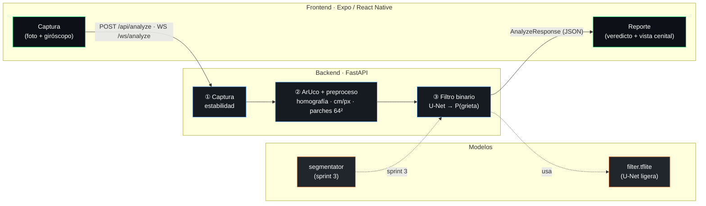
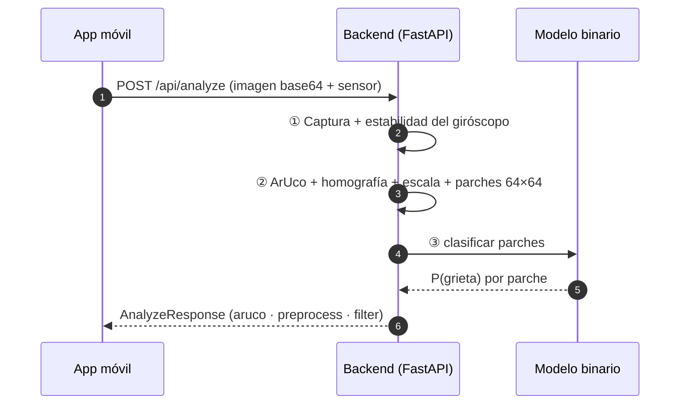

<div align="center">

# Structural Risk Vision

**Visión por computador para la evaluación de riesgo estructural**

Desde una fotografía detecta **grietas**, mide su grosor real y estima el
**nivel de riesgo** (bajo / medio / alto) en infraestructura de concreto.


*Proyecto académico — Algoritmos y Programación 2026-2 · Ingeniería en Inteligencia Artificial · UIS*

</div>

---

## 📌 Resumen y estado

**Qué es.** Un pipeline de visión por computador de 3 etapas que convierte una
foto móvil en un diagnóstico estructural: **① captura guiada** (marcador ArUco +
giróscopo) → **② preprocesamiento** (corrección de perspectiva y escala métrica
real cm/píxel) → **③ filtro binario de grietas** (U-Net muy ligera → TFLite).

**Estado general**

| Componente | Estado |
|------------|:------:|
| Backend (pipeline secciones 1–3, API REST + WebSocket) | ✅ Funcionando |
| Frontend móvil (Expo / React Native) | ✅ Funcionando |
| Modelo binario de grietas (U-Net ligera) | ✅ Entrenado y desplegado |
| Segmentación y severidad (sprint 3) | 🚧 En desarrollo |
| Documentación (`agents/`) | ✅ Completa |

> Cifras reales del modelo y matrices de confusión en
> [`agents/tecnico/stats_modelo_binario.md`](agents/tecnico/stats_modelo_binario.md).

---

## 🏗️ Arquitectura



- **Frontend** — Expo / React Native. Flujo **menú → ubicación → cámara**; envía la foto
  con **giróscopo** (estabilidad), **acelerómetro** (superficie: techo/piso/pared) y el
  **elemento** indicado por el usuario (columna, viga, muro…).
- **Backend** — FastAPI. El ángulo del marcador ArUco permite **rectificar a vista
  cenital**; la superficie se deriva del acelerómetro.
- **Modelos** — filtro binario (`model_binary`) y segmentador (`model_segmentator`, sprint 3).

<details>
<summary><b>Flujo de una inspección (diagrama de secuencia)</b></summary>



</details>

---

## 🚀 Uso rápido

La configuración vive en un **único `.env` en la raíz** (ver [`.env.example`](.env.example)):

```bash
cp .env.example .env     # ajusta APP_MODE, API_PORT, EXPO_PUBLIC_API_URL…
```

<table>
<tr><th>Backend (FastAPI)</th><th>Frontend (Expo)</th></tr>
<tr valign="top">
<td>

```bash
cd backend
python -m venv .venv
source .venv/bin/activate
pip install -r requirements.txt
uvicorn app:app --reload --port 8000
```

API interactiva en <http://localhost:8000/docs>

</td>
<td>

```bash
cd frontend
npm install
npm start
```

Escanea el QR con Expo Go

</td>
</tr>
</table>

- `APP_MODE=demo` (default) → reporte sintético para probar el frontend sin hardware.
- `APP_MODE=prod` → pipeline real; sin `.tflite` responde `SIN_MODELO` (nunca datos falsos).

### Flujo de la app

1. **Menú** — pantalla inicial ligera (no entra directo a la cámara).
2. **Ubicación** — se elige el **elemento estructural** (columna, viga, muro, losa, piso, techo, otro) y se describe la ubicación.
3. **Cámara** — se encuadra la grieta junto al marcador ArUco. La app lee **giróscopo** (estabilidad) y **acelerómetro** (superficie: techo/piso/pared) y envía todo con la foto.
4. **Reporte** — veredicto del filtro, vista cenital rectificada, superficie, elemento, inclinación de captura y confianza.

> El **ángulo del marcador ArUco** rectifica la imagen a **vista cenital** (fronto-paralela) y la **superficie** se infiere del acelerómetro. Detalles en [`agents/tecnico/arquitectura.md`](agents/tecnico/arquitectura.md) y contrato en [`agents/tecnico/api_contrato.md`](agents/tecnico/api_contrato.md).

---

## 🧭 Directorio de accesibilidad

¿Qué necesitas hacer? → ve directo al documento.

| Necesidad | Documento |
|-----------|-----------|
| Entender **qué es** el proyecto y su alcance | [`agents/vision/objetivos.md`](agents/vision/objetivos.md) |
| Ver la **arquitectura** y el flujo de datos | [`agents/tecnico/arquitectura.md`](agents/tecnico/arquitectura.md) |
| **Consumir la API** (endpoints y esquemas) | [`agents/tecnico/api_contrato.md`](agents/tecnico/api_contrato.md) |
| **Correr** backend/frontend y configurar `.env` | [`agents/guias/desarrollo.md`](agents/guias/desarrollo.md) |
| **Entrenar/evaluar** el modelo binario | [`agents/guias/entrenamiento.md`](agents/guias/entrenamiento.md) |
| Ver **métricas** del modelo (F1, confusión, recall, selección de época, overfitting) | [`agents/tecnico/stats_modelo_binario.md`](agents/tecnico/stats_modelo_binario.md) |
| **Cifras** listas para presentación | [`agents/datos/cifras_clave.md`](agents/datos/cifras_clave.md) |
| Hacer una **presentación** con call-to-actions | [`agents/vision/presentacion.md`](agents/vision/presentacion.md) |
| **Navegar el código** (índice estructural) | [`agents/guias/graphify.md`](agents/guias/graphify.md) |
| **Índice completo** de la documentación | [`agents/README.md`](agents/README.md) |

---

## 📂 Estructura del repositorio

```
structural-risk-vision/
├── backend/            # API FastAPI + modelos (backend/model/model_binary|model_segmentator)
├── frontend/           # App móvil Expo / React Native (frontend/src/)
├── EDA/                # Cuadernos Jupyter + datasets (EDA/notebooks/, EDA/data/)
├── agents/             # Documentación (vision/, tecnico/, datos/, guias/)
├── graphify-out/       # Índice estructural del código (generado, no versionado)
├── .env.example        # Plantilla de configuración (raíz)
├── README.md
└── LICENSE
```

---

## 🗺️ Roadmap

| Sprint | Alcance | Estado |
|:------:|---------|:------:|
| **1** | Captura, ArUco, preprocesamiento y contrato del filtro binario | ✅ Hecho |
| **2** | Modelo binario entrenado (U-Net ligera) e inclinación con OpenCV | ✅ Hecho |
| **3** | Segmentación, distancia, clasificación multiclase (Nivel 1–3), Grad-CAM y riesgo | 🚧 En desarrollo |

---

<div align="center">

Distribuido bajo la licencia [MIT](LICENSE).

</div>
