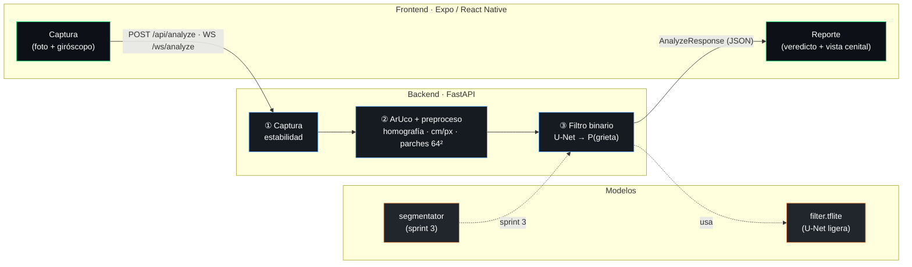
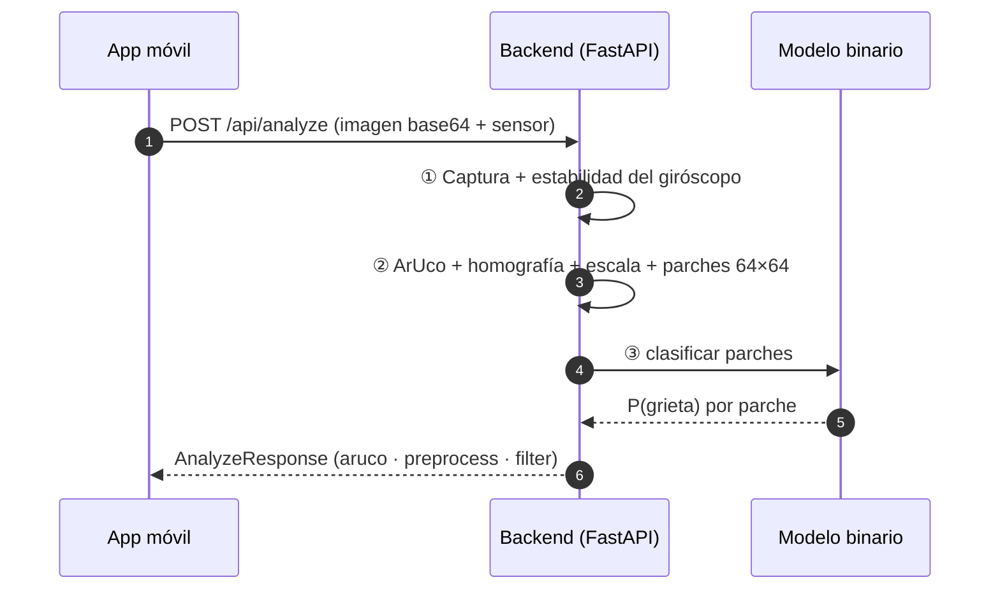

<div align="center">

# Structural Risk Vision

**Visión por computador para la evaluación de riesgo estructural**

Desde una fotografía detecta **grietas**, mide su grosor real y estima el
**nivel de riesgo** (bajo / medio / alto) en infraestructura de concreto.


*Proyecto académico — Algoritmos y Programación 2026-2 · Ingeniería en Inteligencia Artificial · UIS*

</div>

---

## 📌 Resumen y estado

**Qué es.** Un pipeline de visión por computador de 3 etapas que convierte una
foto móvil en un diagnóstico estructural: **① captura guiada** (marcador ArUco +
giróscopo) → **② preprocesamiento** (corrección de perspectiva y escala métrica
real cm/píxel) → **③ filtro binario de grietas** (U-Net muy ligera → TFLite).

**Estado general**

| Componente | Estado |
|------------|:------:|
| Backend (pipeline secciones 1–3, API REST + WebSocket) | ✅ Funcionando |
| Frontend móvil (Expo / React Native) | ✅ Funcionando |
| Modelo binario de grietas (U-Net ligera) | ✅ Entrenado y desplegado |
| Inclinación del elemento (Canny + Hough) | ✅ Funcionando |
| EDA real ejecutado y versionado (METU) | ✅ Con salidas |
| App preparada para inferencia real (`APP_MODE=prod`) | ✅ Funcionando |
| Segmentación y severidad (sprint 3) | 🚧 En desarrollo |
| Documentación (`agents/`) | ✅ Completa |

> Cifras reales del modelo y matrices de confusión en
> [`agents/tecnico/stats_modelo_binario.md`](agents/tecnico/stats_modelo_binario.md).
> Predicción de ejemplo del pipeline completo en
> [`agents/datos/ejemplo_prediccion/`](agents/datos/ejemplo_prediccion/).

---

## 🏗️ Arquitectura



- **Frontend** — Expo / React Native. Flujo **menú → ubicación → cámara**; envía la foto
  con **giróscopo** (estabilidad), **acelerómetro** (superficie: techo/piso/pared) y el
  **elemento** indicado por el usuario (columna, viga, muro…).
- **Backend** — FastAPI. El ángulo del marcador ArUco permite **rectificar a vista
  cenital**; la superficie se deriva del acelerómetro.
- **Modelos** — filtro binario (`model_binary`) y segmentador (`model_segmentator`, sprint 3).

<details>
<summary><b>Flujo de una inspección (diagrama de secuencia)</b></summary>



</details>

---

## 🚀 Uso rápido

La configuración vive en un **único `.env` en la raíz** (ver [`.env.example`](.env.example)):

```bash
cp .env.example .env     # ajusta APP_MODE, API_PORT, EXPO_PUBLIC_API_URL…
```

<table>
<tr><th>Backend (FastAPI)</th><th>Frontend (Expo)</th></tr>
<tr valign="top">
<td>

```bash
cd backend
python -m venv .venv
source .venv/bin/activate
pip install -r requirements.txt
uvicorn app:app --reload --port 8000
```

API interactiva en <http://localhost:8000/docs>

</td>
<td>

```bash
cd frontend
npm install
npm start
```

Escanea el QR con Expo Go

</td>
</tr>
</table>

- `APP_MODE=demo` (default) → reporte sintético para probar el frontend sin hardware.
- `APP_MODE=prod` → pipeline real; sin `.tflite` responde `SIN_MODELO` (nunca datos falsos).

### Flujo de la app

1. **Menú** — pantalla inicial ligera (no entra directo a la cámara).
2. **Ubicación** — se elige el **elemento estructural** (columna, viga, muro, losa, piso, techo, otro) y se describe la ubicación.
3. **Cámara** — se encuadra la grieta junto al marcador ArUco. La app lee **giróscopo** (estabilidad) y **acelerómetro** (superficie: techo/piso/pared) y envía todo con la foto.
4. **Reporte** — veredicto del filtro, vista cenital rectificada, superficie, elemento, inclinación de captura, inclinación del elemento y confianza.

> El **ángulo del marcador ArUco** rectifica la imagen a **vista cenital** (fronto-paralela) y la **superficie** se infiere del acelerómetro. La **inclinación del elemento** se estima con Canny + Hough sobre la imagen original y se reporta como ángulo aparente respecto al eje vertical/horizontal. Detalles en [`agents/tecnico/arquitectura.md`](agents/tecnico/arquitectura.md) y contrato en [`agents/tecnico/api_contrato.md`](agents/tecnico/api_contrato.md).

---

## 🔎 Inferencia real desde la app

1. Verifica que exista el modelo local (no versionado):

```bash
python backend/scripts/verificar_inferencia.py
```

2. Activa el pipeline real en el `.env` de la raíz:

```bash
APP_MODE=prod
EXPO_PUBLIC_API_URL=http://<IP-LAN-de-tu-equipo>:8000
```

3. Levanta el backend y la app:

```bash
cd backend && uvicorn app:app --host 0.0.0.0 --port 8000
cd frontend && npm start
```

4. En la app, pulsa **Probar conexión** en el menú. Debe mostrar
   `inferencia real` y `Modelo: cargado`. Si muestra `demo`, revisa `APP_MODE`;
   si muestra `no disponible`, coloca `filter.tflite`.

> La app muestra un badge **Modo demo** o **Inferencia real** en el reporte, y
> advierte cuando el backend responde `SIN_MODELO`.

### Predicción de ejemplo

Escena reproducible con una grieta real de METU + marcador ArUco sintético:

| Entrada | Salida anotada |
|---------|----------------|
|  |  |

- JSON: [`agents/datos/ejemplo_prediccion/salida.json`](agents/datos/ejemplo_prediccion/salida.json)
- Generar de nuevo: `python backend/scripts/prediccion_ejemplo.py`
- Documentación: [`agents/tecnico/ejemplo_prediccion.md`](agents/tecnico/ejemplo_prediccion.md)

---

## 🧪 Sustentación técnica de decisiones

Esta sección explica **por qué** usamos estos datos, variables e hiperparámetros,
y qué problemas encontramos. La bitácora completa está en
[`agents/tecnico/bitacora_errores.md`](agents/tecnico/bitacora_errores.md).

### Datos y EDA

| Decisión | Valor | Por qué |
|----------|-------|---------|
| Dataset base | METU (40,000 imágenes: 20k grieta / 20k sin grieta) | Benchmark público, balanceado y con splits oficiales; permite comparar con literatura. |
| Tamaño de imagen | 227×227 original → 64×64 para el modelo | 64×64 reduce cómputo y peso; un parche de grieta no necesita más resolución para el filtro binario. |
| Muestra EDA | 2,000 imágenes por clase (4,000) | Cargar 40,000 imágenes exigía ~6.2 GB solo en píxeles. La muestra es reproducible (`seed=42`) y los conteos completos se calculan sin cargar imágenes. |
| Dataset versionado | No | Son ~318 MB con licencia; se documenta su descarga. Se versionan notebooks ejecutados, figuras y resultados. |
| Notebook 02 | Simulación etiquetada | No hay máscaras reales de Crack500/CFD en el repositorio. No se presentan como hallazgos reales. |
| Prueba de sombras | 300 imágenes por clase | Permite medir FPR/recall bajo sombra suave y dura sin convertir el EDA en un experimento costoso. |

Variables reproducibles:

- `EDA_DATA_DIR`: ruta a los datos.
- `EDA_SAMPLE_PER_CLASS`: imágenes por clase (`0` = dataset completo).
- `APP_MODE`: `demo` o `prod`.
- `EXPO_PUBLIC_API_URL`: URL del backend para la app.
- `FILTER_THRESHOLD`: umbral de decisión del filtro.

### Modelo e hiperparámetros

| Hiperparámetro | Valor | Sustentación |
|----------------|-------|--------------|
| Entrada | 64×64×3, normalizada a [0,1] | Coincide con el parche del pipeline; 640/64 = 10 → 100 parches por vista cenital. |
| Modelo desplegado | U-Net ligera | F1 0.9976, 121,883 parámetros, 492 KB. Mejor relación precisión/tamaño que MobileNetV2. |
| Baseline | MobileNetV2 (`alpha=0.35`) | F1 0.9974, 411,489 parámetros, 1.6 MB; más rápido (0.163 ms/parche) pero más pesado y con sobreajuste leve. |
| Train | 2,000 imágenes por clase | Balanceado y viable en CPU (~547 s para U-Net). |
| Validación | 1,000 imágenes por clase | Control de época y early stopping sin tocar test. |
| Test | 4,000 por clase (8,000) | Evaluación final balanceada. |
| Batch | 64 | Compromiso entre estabilidad de gradiente y memoria en CPU. |
| Optimizador | Adam, `lr=1e-3` | Convergencia rápida en un modelo pequeño; fine-tuning de MobileNet usa `lr/10`. |
| Pérdida | Binary cross-entropy | Problema binario con salida sigmoide. |
| Épocas máximas | 30 (U-Net) · 12 + 6 fine-tuning (MobileNet) | El early stopping decide antes; U-Net paró en 22 con mejor época 16. |
| Early stopping | `val_auc`, paciencia 6 | Evita sobreajuste y elige la época por capacidad de ranking, no solo accuracy. |
| `ReduceLROnPlateau` | factor 0.5, paciencia 3, `min_lr=1e-5` | Estabiliza la convergencia cuando `val_loss` se estanca. |
| Augmentación | flips, rotaciones 90/180/270, brillo ±0.12, contraste 0.85–1.15 | Aumenta variedad sin deformar la geometría de la grieta. |
| Umbral de inferencia | 0.5 | Neutro y no ajustado a test. Los umbrales “óptimos” (0.54 U-Net, 0.26 MobileNet) se reportan solo como diagnóstico para evitar leakage. |

### Cifras y cómo leerlas

- **F1 0.9976 / recall 0.9980 / ROC-AUC 0.9996** en 8,000 imágenes de test.
- **FP=11, FN=8** para U-Net. En seguridad estructural, un FN (grieta no vista)
  suele ser más costoso que un FP; por eso se reporta recall además de accuracy.
- **Accuracy sola no basta**: con clases balanceadas puede ocultar el intercambio
  entre FP y FN. Por eso se reportan precision, recall, specificity, F1 y AUC.
- **F1 ≈ 1.0 no significa “problema resuelto”**: METU está casi saturado y el
  dominio real (vista cenital móvil) es distinto. La métrica que falta es la
  evaluación en ese dominio.

### Evidencia del problema de sombras

En una muestra de 300 imágenes por clase:

| Escenario | Recall | Specificity | FPR | FP | FN |
|-----------|--------|-------------|-----|----|----|
| Base | 0.9667 | 0.9833 | 0.0167 | 5 | 10 |
| Sombra suave | 0.9533 | 0.9833 | 0.0167 | 5 | 14 |
| Sombra dura | 1.0000 | 0.0133 | **0.9867** | **296** | 0 |
| Sombra dura + CLAHE | 0.9967 | 0.1800 | 0.8200 | 246 | 1 |
| Base + CLAHE | 0.9700 | 0.9533 | 0.0467 | 14 | 9 |

Decisiones derivadas:

1. No se activó CLAHE por defecto: reduce el FPR bajo sombra dura, pero empeora
   la especificidad en imágenes normales.
2. Se corrigió el orden de canales **BGR→RGB** en inferencia.
3. La app recomienda **luz difusa y evitar sombras duras**.
4. La augmentación de sombras queda como línea de reentrenamiento, no como algo
   ya desplegado.
5. El experimento queda como prueba de regresión para futuros modelos.

### Pipeline y variables geométricas

| Variable | Valor | Por qué |
|----------|-------|---------|
| `PATCH_SIZE` | 64 px | Coincide con la entrada del modelo y permite 100 parches en una vista de 640×640. |
| `NORM_SIZE` | 640 px | Resolución suficiente para medir grietas y mantener el costo de inferencia bajo. |
| `REAL_MARKER_SIZE_CM` | 5 cm | Tamaño físico conocido del marcador; base de la escala cm/píxel. |
| `MAX_TILT_DEG` | 35° | Tolerancia práctica de captura; por encima, la homografía extrapola demasiado. |
| Canny | ratios 0.66 / 1.33 sobre la mediana | Umbrales adaptativos a iluminación. |
| Hough | umbral 45, línea mínima 20% del lado menor, gap 3% | Busca bordes largos del elemento y descarta texturas pequeñas. |
| Tolerancia de eje | ±30° | Agrupa rectas del mismo elemento y descarta diagonales de grietas. |
| Confianza mínima | 0.25 de longitud inlier | Evita reportar una inclinación con pocas rectas. |

La inclinación es **aparente respecto al eje de la imagen/marcador**. No es una
medición absoluta respecto a la gravedad; para eso haría falta un inclinómetro o
una referencia externa.

---

## 🧭 Directorio de accesibilidad

¿Qué necesitas hacer? → ve directo al documento.

| Necesidad | Documento |
|-----------|-----------|
| Entender **qué es** el proyecto y su alcance | [`agents/vision/objetivos.md`](agents/vision/objetivos.md) |
| Ver la **arquitectura** y el flujo de datos | [`agents/tecnico/arquitectura.md`](agents/tecnico/arquitectura.md) |
| **Consumir la API** (endpoints y esquemas) | [`agents/tecnico/api_contrato.md`](agents/tecnico/api_contrato.md) |
| **Correr** backend/frontend y configurar `.env` | [`agents/guias/desarrollo.md`](agents/guias/desarrollo.md) |
| **Entrenar/evaluar** el modelo binario | [`agents/guias/entrenamiento.md`](agents/guias/entrenamiento.md) |
| Ver **métricas** del modelo (F1, confusión, recall, selección de época, overfitting) | [`agents/tecnico/stats_modelo_binario.md`](agents/tecnico/stats_modelo_binario.md) |
| Ver una **predicción de ejemplo** del pipeline completo | [`agents/datos/ejemplo_prediccion/`](agents/datos/ejemplo_prediccion/) |
| Ver **errores, imprecisiones y decisiones** del proceso | [`agents/tecnico/bitacora_errores.md`](agents/tecnico/bitacora_errores.md) |
| **Cifras** listas para presentación | [`agents/datos/cifras_clave.md`](agents/datos/cifras_clave.md) |
| Hacer una **presentación** con call-to-actions | [`agents/vision/presentacion.md`](agents/vision/presentacion.md) |
| **Navegar el código** (índice estructural) | [`agents/guias/graphify.md`](agents/guias/graphify.md) |
| **Índice completo** de la documentación | [`agents/README.md`](agents/README.md) |

---

## 📂 Estructura del repositorio

```
structural-risk-vision/
├── backend/            # API FastAPI + modelos + scripts de inferencia
├── frontend/           # App móvil Expo / React Native (frontend/src/)
├── EDA/                # Cuadernos Jupyter + datasets + README de reproducción
├── agents/             # Documentación (vision/, tecnico/, datos/, guias/)
├── graphify-out/       # Índice estructural del código (generado, no versionado)
├── .env.example        # Plantilla de configuración (raíz)
├── README.md
└── LICENSE
```

---

## 🗺️ Roadmap

| Sprint | Alcance | Estado |
|:------:|---------|:------:|
| **1** | Captura, ArUco, preprocesamiento y contrato del filtro binario | ✅ Hecho |
| **2** | Modelo binario entrenado (U-Net ligera), inclinación Canny+Hough y app lista para inferencia | ✅ Hecho |
| **3** | Segmentación, distancia, clasificación multiclase (Nivel 1–3), Grad-CAM y riesgo | 🚧 En desarrollo |

---

<div align="center">

Distribuido bajo la licencia [MIT](LICENSE).

</div>
