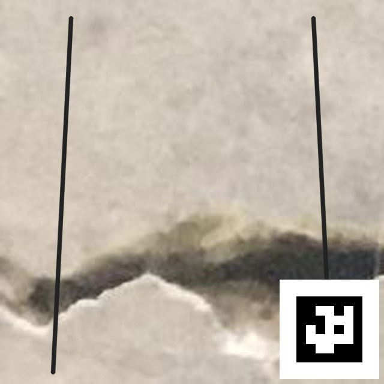
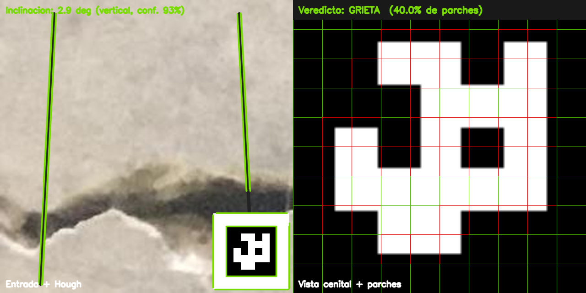

# Predicción de ejemplo — pipeline completo

Ejemplo reproducible de una inferencia de punta a punta: entrada, detección
ArUco, vista cenital, parches, filtro binario e inclinación Canny + Hough.

## Escena

La entrada combina:

- una **grieta real** del set de test de METU (`test/Positive/01848.jpg`),
- un **marcador ArUco sintético** generado en el momento,
- bordes de muro con una inclinación conocida de ~3°.

No es una inspección de campo: es una escena de demostración reproducible.

| Entrada | Salida anotada |
|---------|----------------|
|  |  |

## Resultado (`salida.json`)

| Etapa | Resultado |
|-------|-----------|
| ArUco | Detectado (`marker_id=6`), `cenital_ok=true` |
| Escala | `0.0459 cm/píxel` |
| Área cenital | `29.36 × 29.36 cm` |
| Parches | `100` de `64×64` |
| Filtro | `GRIETA` · `40/100` parches · confianza `0.40` |
| Inclinación | `2.94°` respecto a vertical · confianza `0.93` |

Archivo completo: [`../datos/ejemplo_prediccion/salida.json`](../datos/ejemplo_prediccion/salida.json).

## Reproducir

Requisitos:

- `filter.tflite` local (no versionado).
- Dataset METU en `EDA/data/metu/`.

```bash
python backend/scripts/verificar_inferencia.py
python backend/scripts/prediccion_ejemplo.py
```

El script sobrescribe `entrada.jpg`, `salida.png` y `salida.json` en
`agents/datos/ejemplo_prediccion/`.

## Lectura correcta

- La grieta es real y proviene de METU; el marcador y los bordes del muro son
  sintéticos.
- La inclinación es **aparente respecto al eje de la imagen**, no una medición
  absoluta con inclinómetro.
- El veredicto del filtro es por parches; no sustituye una inspección
  estructural profesional.
