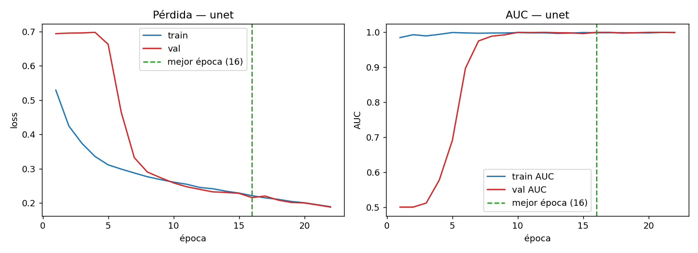
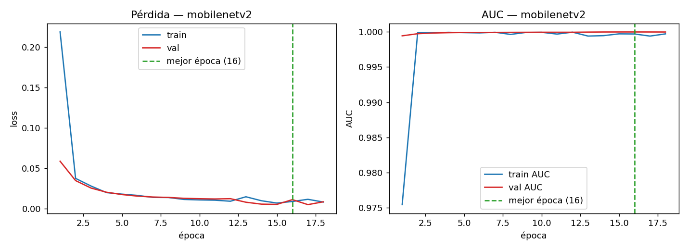

# Métricas del Modelo Binario (Grieta / No-grieta)

Reporte generado automáticamente por `evaluate.py`.

## 1. Dataset de evaluación

- **Fuente**: METU — Concrete Crack Images for Classification (Özgenel, 2019).
- **Set**: `test` con 8000 imágenes (4000 grieta / 4000 sin grieta).
- **Entrada**: RGB 64×64, normalizado a [0, 1].
- **Umbral por defecto**: 0.5.

## 2. Comparación de modelos

| Modelo | Accuracy | Precision | Recall | Specificity | F1 | ROC-AUC | PR-AUC |
|--------|----------|-----------|--------|-------------|----|---------|--------|
| unet | 0.9976 | 0.9973 | 0.9980 | 0.9972 | 0.9976 | 0.9996 | 0.9996 |
| mobilenetv2 | 0.9974 | 0.9990 | 0.9958 | 0.9990 | 0.9974 | 1.0000 | 1.0000 |

## 3.1 Detalle — unet

- Parámetros: **121,883**
- Tamaño TFLite: **492.2 KB**
- Latencia: **1.49 ms/parche** (~671.0 parches/s, CPU)
- Umbral óptimo (mejor F1): **0.54** | Youden J: **0.54**

**Matriz de confusión** (umbral 0.5):

| | Pred: No-grieta | Pred: Grieta |
|---|---|---|
| **Real: No-grieta** | TN=3989 | FP=11 |
| **Real: Grieta** | FN=8 | TP=3992 |

## 3.2 Detalle — mobilenetv2

- Parámetros: **411,489**
- Tamaño TFLite: **1600.3 KB**
- Latencia: **0.163 ms/parche** (~6138.1 parches/s, CPU)
- Umbral óptimo (mejor F1): **0.26** | Youden J: **0.26**

**Matriz de confusión** (umbral 0.5):

| | Pred: No-grieta | Pred: Grieta |
|---|---|---|
| **Real: No-grieta** | TN=3996 | FP=4 |
| **Real: Grieta** | FN=17 | TP=3983 |

## 4. Selección de época y diagnóstico de ajuste

La época se elige por **`ModelCheckpoint(monitor="val_auc", mode="max", save_best_only=True)`**: se guarda el modelo con mejor AUC de validación. El entrenamiento se detiene con **`EarlyStopping(monitor="val_auc", patience=6, restore_best_weights=True)`**.

### unet

- Épocas ejecutadas: **22** · mejor época: **16** (val AUC = 1.0000).
- Early stopping: sí, 6 épocas después de la mejor (paró en la 22).
- Accuracy en la mejor época: train = 0.9973, val = 0.9980 (gap = -0.0008).
- `val_loss` tras la mejor época: no sube.
- **Diagnóstico: ajuste adecuado (sin under/overfitting significativos).**

### mobilenetv2

- Épocas ejecutadas: **18** · mejor época: **16** (val AUC = 1.0000).
- Early stopping: no (se alcanzó el máximo de épocas; paró en la 18).
- Accuracy en la mejor época: train = 0.9967, val = 0.9955 (gap = +0.0012).
- `val_loss` tras la mejor época: sube (señal de sobreajuste).
- **Diagnóstico: sobreajuste (overfitting) leve.**

## 5. Conclusión

- Mejor **F1**: `unet` (0.9976).
- Modelo más **ligero**: `unet` (121,883 parámetros, 492.2 KB).
- Menor **latencia**: `mobilenetv2` (0.163 ms/parche).
- Si el F1 empata, se recomienda el modelo **más ligero** para el filtro rápido en móvil; MobileNetV2 aporta su mejor latencia vía XNNPACK.

## 6. Limitaciones

> Bitácora de errores y decisiones: [`bitacora_errores.md`](bitacora_errores.md).

- METU es un benchmark **casi saturado**: el estado del arte reporta >99% en esta tarea, por lo que un F1 ≈ 1.0 es esperable (y no debe leerse como 'problema resuelto').
- Los índices del set de **test** están entrelazados con **train**, de modo que podrían compartir foto-fuente (METU genera 40k parches desde 458 fotos). La **validación** (bloque contiguo, sin solapamiento de índices) da una exactitud similar, lo que respalda el resultado.
- METU son fotografías de grietas de cerca; los parches reales del pipeline provienen de la vista cenital (dominio distinto). La métrica **real** que importa es el desempeño en ese dominio, aún por medir.
- El modelo es un **filtro rápido** por parche: el veredicto final del pipeline agrega el ratio de parches con grieta.
- Entrenado en CPU con un subconjunto del dataset.
