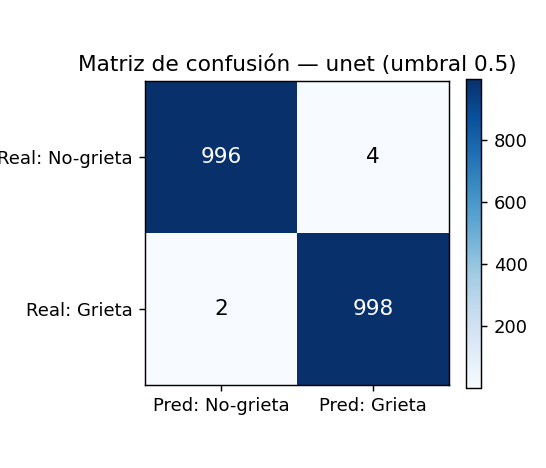
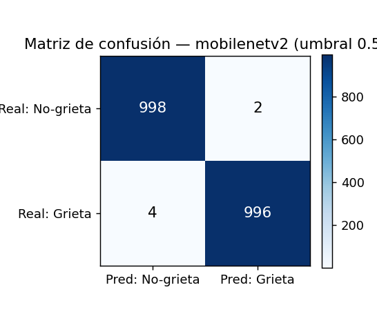

# Métricas del Modelo Binario (Grieta / No-grieta)

Reporte generado automáticamente por `evaluate.py`.

## 1. Dataset de evaluación

- **Fuente**: METU — Concrete Crack Images for Classification (Özgenel, 2019).
- **Set**: `test` con 2000 imágenes (1000 grieta / 1000 sin grieta).
- **Entrada**: RGB 64×64, normalizado a [0, 1].
- **Umbral por defecto**: 0.5.

## 2. Comparación de modelos

| Modelo | Accuracy | Precision | Recall | Specificity | F1 | ROC-AUC | PR-AUC |
|--------|----------|-----------|--------|-------------|----|---------|--------|
| unet | 0.9970 | 0.9960 | 0.9980 | 0.9960 | 0.9970 | 0.9995 | 0.9995 |
| mobilenetv2 | 0.9970 | 0.9980 | 0.9960 | 0.9980 | 0.9970 | 0.9999 | 0.9999 |

## 3.1 Detalle — unet

- Parámetros: **121,883**
- Tamaño TFLite: **492.2 KB**
- Latencia: **1.412 ms/parche** (~708.2 parches/s, CPU)
- Umbral óptimo (mejor F1): **0.54** | Youden J: **0.54**

**Matriz de confusión** (umbral 0.5):

| | Pred: No-grieta | Pred: Grieta |
|---|---|---|
| **Real: No-grieta** | TN=996 | FP=4 |
| **Real: Grieta** | FN=2 | TP=998 |

## 3.2 Detalle — mobilenetv2

- Parámetros: **411,489**
- Tamaño TFLite: **1600.3 KB**
- Latencia: **0.16 ms/parche** (~6243.2 parches/s, CPU)
- Umbral óptimo (mejor F1): **0.31** | Youden J: **0.31**

**Matriz de confusión** (umbral 0.5):

| | Pred: No-grieta | Pred: Grieta |
|---|---|---|
| **Real: No-grieta** | TN=998 | FP=2 |
| **Real: Grieta** | FN=4 | TP=996 |

## 4. Conclusión

- Mejor **F1**: `unet` (0.9970).
- Modelo más **ligero**: `unet` (121,883 parámetros, 492.2 KB).
- Menor **latencia**: `mobilenetv2` (0.16 ms/parche).
- Si el F1 empata, se recomienda el modelo **más ligero** para el filtro rápido en móvil; MobileNetV2 aporta su mejor latencia vía XNNPACK.

## 5. Limitaciones

- METU es un benchmark **casi saturado**: el estado del arte reporta >99% en esta tarea, por lo que un F1 ≈ 1.0 es esperable (y no debe leerse como 'problema resuelto').
- Los índices del set de **test** están entrelazados con **train**, de modo que podrían compartir foto-fuente (METU genera 40k parches desde 458 fotos). La **validación** (bloque contiguo, sin solapamiento de índices) da una exactitud similar, lo que respalda el resultado.
- METU son fotografías de grietas de cerca; los parches reales del pipeline provienen de la vista cenital (dominio distinto). La métrica **real** que importa es el desempeño en ese dominio, aún por medir.
- El modelo es un **filtro rápido** por parche: el veredicto final del pipeline agrega el ratio de parches con grieta.
- Entrenado en CPU con un subconjunto del dataset.
